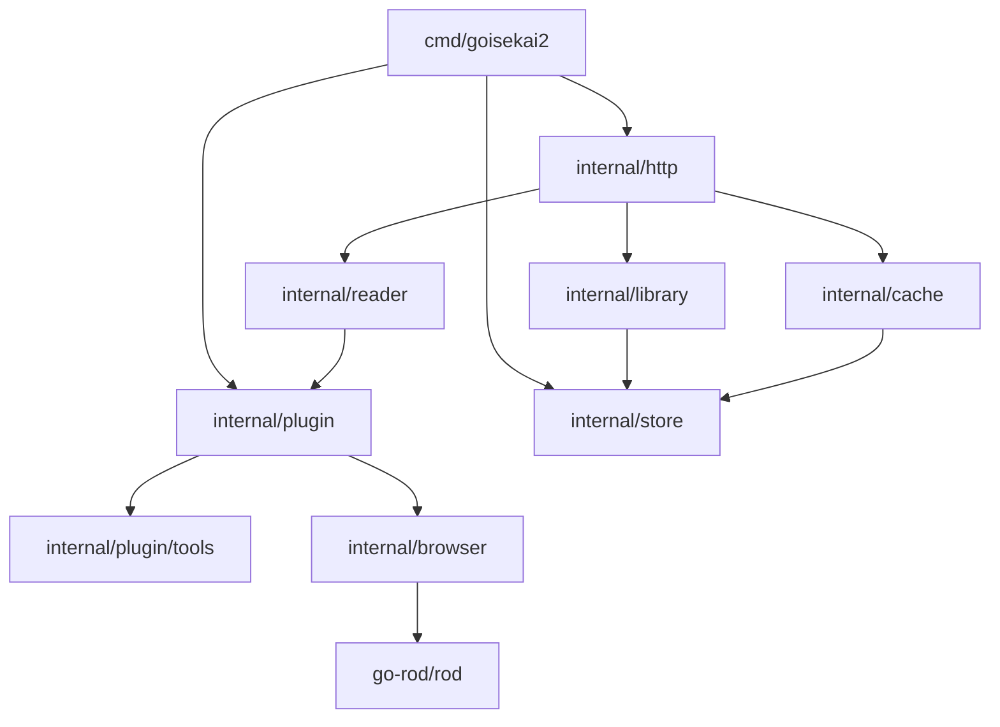
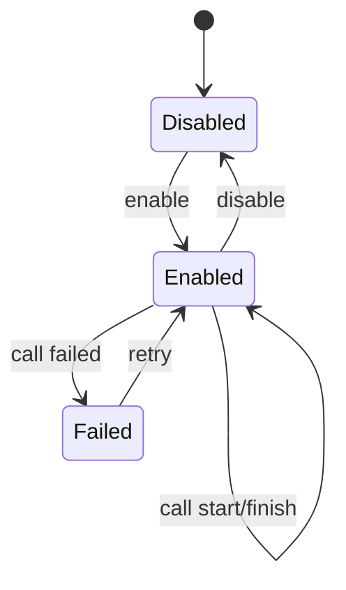

# goIsekai2

Local-first manga viewer with a plugin-per-site runtime, disk cache, reader UI and tray-capable
daemon. Go rewrite of cppIsekai; pure Go, no cgo.

## Quick start

```bash
make build
./scripts/install-plugins data
go run ./cmd/goisekai2 --dump-config goisekai.ini
# edit goisekai.ini, then:
./bin/goisekai2 --config goisekai.ini
```

Open `http://127.0.0.1:8090/`.

## Architecture



Every layer has one owner: the store is the only SQL speaker, the event bus has one actor, the
stream hub fans out log lines over WebSocket, and each plugin runtime allows one guest call at a
time.

## State machines

Plugin and job lifecycles use `qmuntal/stateless`; cache entries use a small typed enum.



## Plugin corpus

`plugins/lua`, `plugins/js` and `plugins/enrichment` hold the ported corpus. `plugins/PARITY.md`
records every baseline `plugins_dev/` folder as ported or omitted with a reason. The mangadex plugin
is the canonical ABI reference. `scripts/install-plugins <data-dir>` copies the corpus into the
runtime data directory.

## Status

All 11 capability specs are ported from the cppIsekai baseline and implemented in order:
config, store, plugin-host, host-tools, library, reader, image-cache, detail, updates, browser,
sites. Build gates: `make test lint`, `CGO_ENABLED=0 go build ./...`, `okf validate` and
`openspec validate --specs`.
