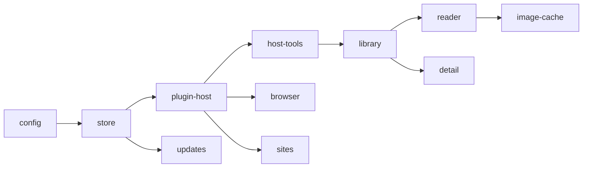

## Why a map instead of 25 ports

The baseline carries 25 capability specs accumulated across archived changes. Several are superseded
(`cache-layout` by `cache-layout-v3`), several are page-level slices of one feature (`search-page` +
`search-cache`, `detail-enrichment` + `detail-enrichment-fields`), and three are the same plugin contract seen
through different runtimes (`lua-runtime`, `js-runtime`, `wasm-runtime`). Porting them one-to-one would duplicate
requirements and preserve a document history that only makes sense in the C++ repo.

V2 maps them onto 11 capabilities, one file each, written fresh: requirement text and testable scenarios ported,
prose and archive annotations dropped, and the V2 decision applied where it differs.

## Mapping

| V2 capability | Baseline source specs | Change in V2 |
|---|---|---|
| `config` | `cli-config`, `settings-page` | env prefix `GOISEKAI_*`, provenance reporting, immutable snapshot, restart-only knobs declared as such |
| `store` | `chapter-store`, `library-save` (write side), `search-cache` (`api_cache`) | `schema_version` table, FSM state columns, `jobs` table, single connection with a non-nesting Tx helper |
| `plugin-host` | `plugin-system`, `plugins-page`, `lua-runtime`, `js-runtime`, `wasm-runtime` | one runtime interface, `qmuntal/stateless` lifecycle (disabled/enabled(idle/busy)/failed), quickjs + wazero + gopher-lua |
| `host-tools` | `host-tools`, `plugin-host-tools` | same tool names and envelopes; the tool table is explicit, plugins never see the event bus or the DB |
| `library` | `library-save`, `search-page`, `search-cache` (read side) | unchanged surface; covers the save/remove/pin/status flows |
| `reader` | `reader-page`, `reader-fullscreen`, `chapter-list-controls` | unchanged window math (limit 10, strictly-after), prefetch as a direct call |
| `image-cache` | `image-cache`, `cache-layout`, `cache-layout-v3` | v3 layout only; pure-Go transcode instead of libvips; no-context images are not cached |
| `detail` | `manga-detail-page`, `detail-enrichment`, `detail-enrichment-fields` | unchanged; enrichment plugins stay optional and namespaced per plugin |
| `updates` | `auto-update` | durable `jobs` rows replace `update_attempts` bookkeeping; retry/backoff is an FSM |
| `browser` | `browser-host` | supervisor owns only the child it spawned; adopted external backends survive shutdown |
| `sites` | `mangadex-plugin` | the reference plugin, kept as the parity fixture for the plugin ABI |

`cache-layout-v3` semantics win over `cache-layout` wherever they disagree; where the baseline spec and the
baseline code disagree, the **code** wins and the divergence is recorded (`architecture/cache-layout` documents the
one such correction: there is no sha1 fallback for images without placement context).

## Porting rules

1. One file per capability: `openspec/specs/<capability>/spec.md`, with a real `## Purpose` paragraph (the baseline
   has several `TBD - created by archiving change` purposes, which are not worth inheriting).
2. Requirements keep their observable contract: routes, payload shapes, config keys, env names, file paths, status
   vocabulary. Internal names are free.
3. Every requirement gets at least one `#### Scenario:` with a WHEN/THEN that a test could assert. A requirement
   without a scenario is not ported.
4. Deltas between baseline and V2 go into the requirement text and into `knowledge/decisions/*`, never into a
   silent rewrite.
5. `openspec validate --specs` must pass after every capability lands.

## Porting order and why

Each capability is specified only after the ones it imports are specified, so a requirement never needs a forward
reference to fill in a contract. `sites` comes last because it exercises everything: it is the integration fixture
that proves the plugin ABI, the host tools and the store all agree.

## Definition of done per capability

- `openspec validate --specs` clean.
- Every requirement has a scenario, and every scenario names a concrete input or observable output.
- Divergences from the baseline are listed in the capability's own requirements or in a linked decision concept.
- No requirement depends on a capability that has not been specified yet.

# Related Concepts
- [Architecture overview: layers, import rules and frozen external contracts](overview.md): the capability layer split that mirrors the architecture layers
- [Capability porting order](../process/porting-order.md): the execution sequence and per-change gates that turn this map into one OpenSpec change at a time
