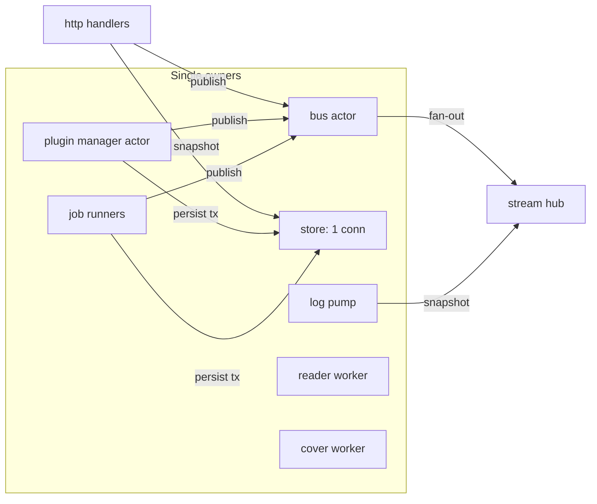

## Rule zero

Every mutable thing has exactly one owner. If two goroutines can mutate it, the design is wrong -- not the
locking. This is the lesson from the baseline: a single shared SQLite connection plus a recursive mutex plus
in-flight tracking (`knowledge/findings/store-serialized-ops.md`) works, but one throw without the guard
wedges every later transaction.

## Ownership table

| Resource | Owner | Access rule | Limit |
|---|---|---|---|
| Config | one reload goroutine | `atomic.Pointer[Config]`; readers copy the pointer, never mutate | one snapshot generation |
| SQLite | `store` | `*sql.DB` with `MaxOpenConns(1)`, WAL, `busy_timeout`; transactions never nest | 1 writer |
| Event bus | bus actor goroutine | only the actor touches `*event.Manager` | 1 |
| Stream hub | hub goroutine + per-client buffer | publish = append + drop-oldest; never blocks publisher | per-client cap |
| Plugin registry | plugin manager actor | owns `map[id]*instance` and every FSM; `Fire` serialized | 1 |
| Plugin runtime slot | per-plugin semaphore | one guest call at a time (baseline: runtime mutex) | 1 per plugin |
| Fetcher | semaphore | global in-flight cap + per-host cap | configurable |
| Jobs | bounded queue + N runners | `Queued` rows enqueued in FIFO; cancel by version | N (default 2) |
| Reader prefetch | one worker | coalescing: newest request replaces pending | 1 pending |
| Cover prefetch | one worker | cache-first, coalescing | 1 pending |
| Log ring | one pump goroutine | append + 200-line ring; readers get a snapshot copy | 200 lines |
| HTTP handlers | stateless | no locks held across I/O; request-scoped only | Go scheduler |

## SQLite serialization

- `MaxOpenConns(1)` makes the driver the serializer; no recursive mutex, no hand-rolled op tracer.
- One transaction helper: `store.Tx(ctx, func(tx) error)`. It rejects re-entry via a context marker, so a
  nested call returns an error instead of deadlocking on the single connection.
- Pragmas: WAL, `synchronous=NORMAL`, `busy_timeout=5000`, foreign keys on. Same durability class as the
  baseline (`store_core.cpp:90-96`).
- Migrations: additive only, ordered, idempotent, applied inside one transaction, with the target version in
  a `schema_version` table (the baseline has no `user_version` and relies on `sync_schema()` plus manual
  ALTERs -- we keep the additive discipline, not the missing version row).
- Long reads never hold the connection while doing I/O: read, close, then work.

## Backpressure policy

| Path | Policy | Rationale |
|---|---|---|
| Domain events | bounded per-subscriber queue, drop-newest only for non-critical listeners; core listeners never drop | facts must not be lost silently |
| Stream (logs, progress, grid refresh) | drop-oldest per client | a slow browser must not stall the daemon |
| Plugin calls | wait on the per-plugin slot, bounded by request context | one guest call at a time |
| Image fetch | singleflight per cache key + deadline | duplicate fetches are waste |
| Jobs | bounded queue, reject with a typed error when full | visible failure over unbounded memory |
| Fetcher | global + per-host semaphore | avoid self-inflicted rate limits |

## Timeouts and cancellation

| Operation | Default | Source |
|---|---|---|
| Plugin HTTP fetch | 30 s | baseline `fetch_timeout_ms` |
| Guest instruction budget | per-runtime budget (Lua hook analog) | baseline `instruction_budget` 5e6 |
| Job | configurable, `TrigTimeout` -> `Failed` | new |
| Image fetch | 30 s | baseline |
| Shutdown drain | 10 s then force | new |

`context.Context` is the only cancellation channel: no global stop flags, no channel closes from receivers.

## Shutdown ladder

1. HTTP stops accepting (server shutdown, in-flight handlers get the deadline).
2. Scheduler stops (no new jobs).
3. Job runners drain; queued jobs stay `Queued` in the store for the next boot.
4. Plugin manager stops: no new calls, in-flight calls get the deadline, runtimes released.
5. Bus actor drains its queue, then stops.
6. Stream hub closes client buffers.
7. Prefetch workers exit, cache flushes its index.
8. Store closes.

Any resource that cannot be drained in time is logged with its owner and leaked by design rather than
killed mid-write.

## Forbidden patterns

- A goroutine per event or per request without a bound.
- Holding a mutex across a network call, a guest call or a transaction.
- Unbounded queues; `chan T` with no capacity policy.
- Closing a channel from the receiving side.
- Nested transactions; panic-driven control flow inside actors.
- `time.Sleep` as a retry mechanism; retries are scheduled or driven by the job machine.

## Gates

- `go test -race ./...` on every lane that touches an owner.
- Goroutine-leak check around boot/shutdown for each owner.
- Deterministic clock injected into timeouts and backoff so tests do not sleep.
- One test per backpressure policy proving the publisher never blocks (stream) and the queue never grows
  without bound (jobs).

# Related Concepts
- [Event-driven core: domain events on gookit/event, stream plane separate](event-driven-core.md): the bus actor is one of the single owners in this model
