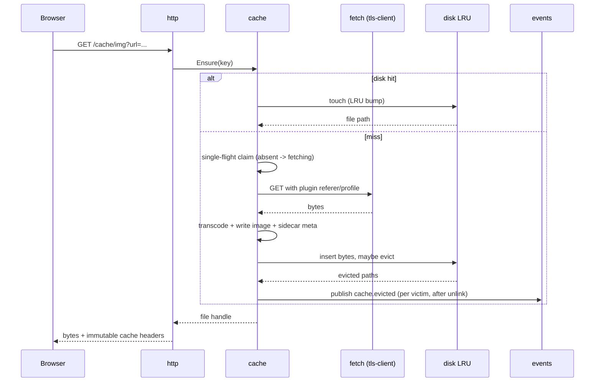
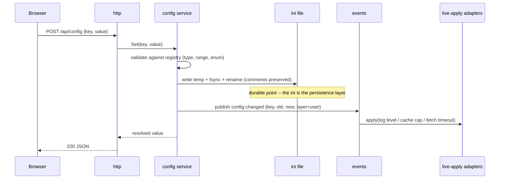

## Why this document exists

Ordering is the whole design. Five flows touch more than one owner, and each one has exactly one correct order of
operations. If any of them publishes before commit, serves before fetch, or blocks on the stream plane, the
behaviour drifts from the baseline. Everything below is stated as an ordered sequence with the commit point
marked explicitly.

Global rules used by every flow:

1. Reads are store-first. Network work happens only on a miss, a stale hit, or an explicit refresh.
2. A write commits, then publishes. Nothing is published inside a transaction, and a rolled-back write emits nothing.
3. A subscriber never reads the DB, calls HTTP, or calls a plugin. It enqueues a nudge or pushes to the stream hub.
4. Stream delivery is lossy (drop-oldest per subscriber). Domain events are not: they are synchronous and must not fail.

## Flow 1 -- save a manga from search

```mermaid
sequenceDiagram
  participant B as Browser
  participant H as http
  participant L as library service
  participant P as plugin host
  participant D as SQLite
  participant E as events
  participant W as workers
  participant S as stream
  B->>H: POST /api/library {plugin, slug}
  H->>L: Save(ctx, key)
  alt detail not cached
    L->>P: call(get_manga_detail)
    P-->>L: JSON envelope
  end
  L->>D: BEGIN; upsert saved_manga; COMMIT
  Note over D: commit point -- nothing published before this line
  L->>E: publish library.saved
  E->>W: cover prefetch nudge (coalesced)
  E->>S: grid row patch
  L-->>H: saved row
  H-->>B: 200 JSON
```

- The plugin call happens **before** the transaction, so a slow or failing fetch never holds the single DB
  connection (see `concurrency-ownership`: one connection, no nested transactions).
- `library.saved` is published once. Re-saving an already-saved title emits `library.saved` again only if the row
  actually changed (status, metadata); the event is a fact about the commit, not about the click.
- The cover prefetch nudge is coalesced on `(plugin, slug)` so a burst of saves does not spawn a burst of fetches.

## Flow 2 -- open a chapter (pages + position)

```mermaid
sequenceDiagram
  participant B as Browser
  participant H as http
  participant R as reader service
  participant P as plugin host
  participant D as SQLite
  participant E as events
  participant C as image cache
  participant W as page prefetcher
  B->>H: GET /api/pages/:plugin/:slug/:ch
  H->>R: Pages(ctx, key, chapter)
  R->>D: SELECT pages WHERE ch = ?
  alt rows missing or stale
    R->>P: call(get_page_list)
    P-->>R: JSON envelope
    R->>D: BEGIN; upsert pages; COMMIT
  end
  R-->>H: page list (limit 10, strictly after position)
  H-->>B: JSON
  H->>W: prefetch next window (fire and forget)
  W->>C: ensure(url) for each page, bounded 2 concurrent
  B->>H: POST /api/position {plugin, slug, ch, page}
  H->>D: BEGIN; upsert position; COMMIT
  H->>E: publish library.read
  H-->>B: 204
```

- Window math is frozen: limit 10, strictly-after the stored position, per chapter. Do not invent a lookahead the
  baseline does not have.
- Prefetch is a direct interface call (`reader.Prefetch`), **not** an event: it has a return value, a bound and a
  cancellation, so it stays a function call (see `event-driven-core`).
- Position writes are debounced by the browser (one write per navigation, not per scroll) and each committed write
  publishes exactly one `library.read`.

## Flow 3 -- serve a cached image



- Single-flight is mandatory: the grid renders tens of covers at once and the baseline must not fetch the same URL
  twice. A second request for a `fetching` key waits on the first, it does not start its own fetch.
- The sidecar (origin URL, dimensions, byte size, fetched-at) is written before the LRU insert, so a crash between
  the two leaves a recoverable file rather than an unaccounted entry.
- `cache.evicted` is published after the unlink, so a subscriber can never observe a path that still exists.

## Flow 4 -- save config



- Config persistence is the INI file, not SQLite. Ordering is: validate -> atomic file write -> publish -> apply.
- A rejected value never reaches the file. An adapter failure is reported to the caller but does not roll the file
  back: the saved value takes effect on the next boot, which matches the baseline and keeps `--dump-config` honest.
- The registry is the only source of truth for defaults, types and help text; the INI stores user overrides only.

## Flow 5 -- enable or disable a plugin

```mermaid
sequenceDiagram
  participant B as Browser
  participant H as http
  participant M as plugin manager (FSM owner)
  participant R as runtime
  participant D as SQLite
  participant E as events
  participant J as scheduler
  participant S as stream
  B->>H: POST /plugin/:id/enabled {enabled:false}
  H->>M: request Disable
  M->>M: guard -- Enabled and not in a call, else queue or 409
  M->>R: quiesce (no new calls accepted)
  M->>D: BEGIN; persist state=disabled; COMMIT
  M->>E: publish plugin.lifecycle {Disable}
  E->>J: scheduler gate closes for this plugin
  E->>S: badge update
  M-->>H: new state
  H-->>B: 200 JSON
```

- The FSM owns the decision (see `state-machines`); the HTTP layer only translates. An illegal transition returns a
  typed error mapped to `409`, never a 500 and never a silent no-op.
- A call already in flight is allowed to finish (or hits its timeout) before the state is persisted: the baseline
  holds one call per runtime, and killing it mid-flight would corrupt plugin state.
- Disabling is persisted before the event, so a crash right after the write leaves the plugin disabled -- the safe
  direction. Boot reconciliation then loads it as disabled.

## Ordering invariants (the review checklist)

| Invariant | Where it is enforced |
|---|---|
| Nothing publishes inside a transaction | store Tx helper forbids publish; events only called after commit returns |
| A rolled-back write emits nothing | publish is a separate explicit call after `Commit()` |
| No plugin call while holding the DB connection | plugin calls happen before or after the tx, never inside |
| No subscriber touches the DB, HTTP or a plugin | subscriber bodies only enqueue or push to `stream` |
| Stream push never blocks the publisher | bounded per-subscriber ring, drop-oldest, counter on drop |
| Cache write precedes LRU accounting | sidecar + file first, then insert, then evict event |
| Position writes are idempotent | upsert keyed by `(plugin, slug)`; duplicate writes are harmless |
| Illegal FSM transition is observable | typed error + counter + warn log, never a panic |

# Related Concepts
- [Image cache: v3 layout, namespace by display name, slug rules, LRU and pure-Go transcode](cache-layout.md): the image-serve flow resolves against this tree
