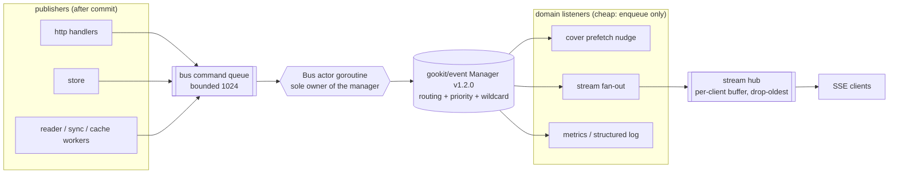

## Position in the layer map

The bus is infrastructure, not a layer: publishers are `http/`, `store/`, `reader/`, `cache/`,
`plugin/`; subscribers are adapters that only enqueue work. No package owns "the bus" as a domain
concept, and `plugin/` (guest runtime) never gets a bus handle — host tools stay explicit.



## Two delivery planes (do not merge them)

| Plane | Mechanism | Semantics | Examples |
|---|---|---|---|
| **Domain events** | gookit manager, fired by the actor goroutine | FIFO, no drop, listener error logged, handler must be sub-millisecond | `library.saved`, `library.read`, `plugin.lifecycle`, `config.changed`, `cache.evicted` |
| **Stream events** | own `internal/stream` hub, NOT gookit | best-effort, per-subscriber bounded buffer, drop-oldest, coalescable | `log.line`, `job.progress`, `library.refresh` (SSE feed) |

Rationale: gookit's async path is a single global channel (`ChannelSize` default 100, 3 consumers) that
**blocks the publisher** when full and has no per-subscriber policy. A slow browser tab must never stall
a log line or a sync worker, so streaming gets its own hub. Everything that must not be lost goes
through the domain plane.

## Event catalog (domain plane)

| Event constant | Value | Payload | Published after | Subscribers |
|---|---|---|---|---|
| `EvtLibrarySaved` | `library.saved` | `LibrarySaved{Plugin, Slug, Status}` | store commit | cover prefetch nudge, SSE refresh |
| `EvtLibraryRead` | `library.read` | `ChapterRead{Plugin, Slug, Chapter, Page}` | store commit | stats invalidation |
| `EvtStatusChanged` | `library.status` | `StatusChanged{Plugin, Slug, From, To}` | store commit | grid refresh, metrics |
| `EvtPluginLifecycle` | `plugin.lifecycle` | `PluginLifecycle{ID, State}` | registry commit | scheduler gate, cache GC, SSE |
| `EvtConfigChanged` | `config.changed` | `ConfigChanged{Key, Old, New, Layer}` | config save commit | live-apply adapters |
| `EvtCacheEvicted` | `cache.evicted` | `CacheEvicted{RelPath, Bytes, Reason}` | LRU eviction | metrics, placeholder state |

Rules:

- Names are dotted lowercase and live as constants in `internal/events`; no string literals at call sites.
- Payload is always one typed struct under the reserved key `payload` (`event.M{"payload": v}`).
- Publish point is **after** the DB transaction commits, never inside it. A rolled-back write emits nothing.
- A listener does not read the DB, call HTTP, or call a plugin. It enqueues a nudge or pushes to the stream hub.

## What is NOT an event

- **Commands**: reader prefetch, cover prefetch, sync job start, cache warm. These are interface calls so the
  caller sees errors and backpressure (`reader.Prefetch(ctx, window)`). An event means "this already happened".
- **Request/response**: plugin host tools (`http.fetch`, `storage.*`, `log.*`). Plugin runtime never sees the bus.
- **Store writes**: direct method calls on the single-writer store. The bus reports, it does not mutate.
- **Cross-process**: tray/GUI ↔ daemon stays HTTP/DB, not a shared memory bus.

## gookit/event internals we must defend against (verified source, v1.2.0)

| Internals | Consequence | Rule |
|---|---|---|
| `Manager` embeds `sync.Mutex`; `fireEvent` locks only when `Options.EnableLock`; `On`/`RemoveListener` mutate `listeners` map and `ListenerQueue.Sort()` sorts the slice in place | concurrent `Fire`/`On` is a data race (map write + in-place sort) | exactly one goroutine calls `Fire/FireEvent/On/RemoveListener` — the actor |
| `EnableLock=true` locks for the whole dispatch (non-reentrant mutex) | a listener that registers or fires an event deadlocks | never enable; the actor already serializes |
| `Async`/`FireAsync` push to one global buffered channel and block when it is full | slow consumer stalls every publisher | never call the async API; use the stream hub instead |
| `Close()` only closes that channel and does not wait for consumers | `FireAsync` after `Close` panics; no drain guarantee | do not use async; drain the actor queue on shutdown |
| `Fire` returns the first listener error and `Abort(true)` stops the chain | one flaky metrics listener can silently skip notifications | listeners never abort; actor logs `err` and continues |
| Payload type is `event.M` = `map[string]any` | every handler would type-assert fields | typed facade: `Publish[T]` / `Listen[T]` |

## Typed facade (why the wrapper exists)

```go
// internal/events — thin typed layer over event.Manager, executed by the actor.
const PayloadKey = "payload"

func Publish[T any](b *Bus, name string, v T) error {
	return b.do(func(em *event.Manager) error { // enqueue; actor calls Accept below
		_, err := em.Fire(name, event.M{PayloadKey: v})
		return err
	})
}

func Listen[T any](b *Bus, name string, fn func(T)) {
	b.do(func(em *event.Manager) error {
		em.On(name, event.ListenerFunc(func(e event.Event) error {
			v, ok := e.Get(PayloadKey).(T)
			if !ok {
				return fmt.Errorf("event %s: payload is %T, want %T", name, e.Get(PayloadKey), v)
			}
			fn(v)
			return nil
		}))
		return nil
	})
}
```

Type assertions happen once, in the adapter. Handlers receive domain structs. `Publish` keeps the
`T` at the call site, so a wrong payload for a name is a compile error in practice and a logged
adapter error at runtime.

## Concurrency contract

1. One actor goroutine is the **only** code that touches `*event.Manager`.
2. `Publish` enqueues into a bounded queue (1024). Domain publishes block with the caller's
   `context` rather than dropping; HTTP handlers pass the request context.
3. Listeners are registered through `Bus.Listen` before the HTTP server starts; the call is acknowledged
   so ordering is deterministic. Late registration (plugin enable) still goes through the actor.
4. Each command runs with `recover()`; a panic is logged with event name and the loop continues.
5. Shutdown order: stop HTTP → stop workers → drain actor queue → close stream hub → stop plugins.
6. `go test -race` is mandatory for `internal/events` and `internal/stream`.

## Failure modes and answers

| Failure | Answer |
|---|---|
| A subscriber is slow (SSE client on a bad link) | stream hub drops oldest for that client only; domain plane untouched |
| A listener panics | recovered per command, logged, other listeners for that event still run |
| Queue full during a burst | publishers wait on their context; sync workers surface the timeout as a retryable error |
| Event emitted then process crashes before the nudge runs | safe by design: nudges are idempotent and the boot scan re-warms state |
| Two events for the same slug race | actor is FIFO; store version column lets listeners ignore stale payloads |

## Testing

- `Bus` tests: FIFO ordering of published events, panic isolation, listener error does not stop the chain,
  no goroutine leak after shutdown (`goleak`).
- `stream` tests: slow subscriber drops oldest, fast subscriber sees every line, publisher never blocks.
- Integration: publish `library.saved` in a store test and assert the prefetch nudge was enqueued (no network).

## Review trigger

If after the first three capability changes the priority/wildcard/`Once`/`Abort` features are unused, drop
`gookit/event` for a ~100-line typed hub. The wrapper is designed so that swap touches only `internal/events`.

# Related Concepts
- Related to [Adopt gookit/event behind a single-actor bus; separate stream plane](../decisions/event-dispatch.md)
