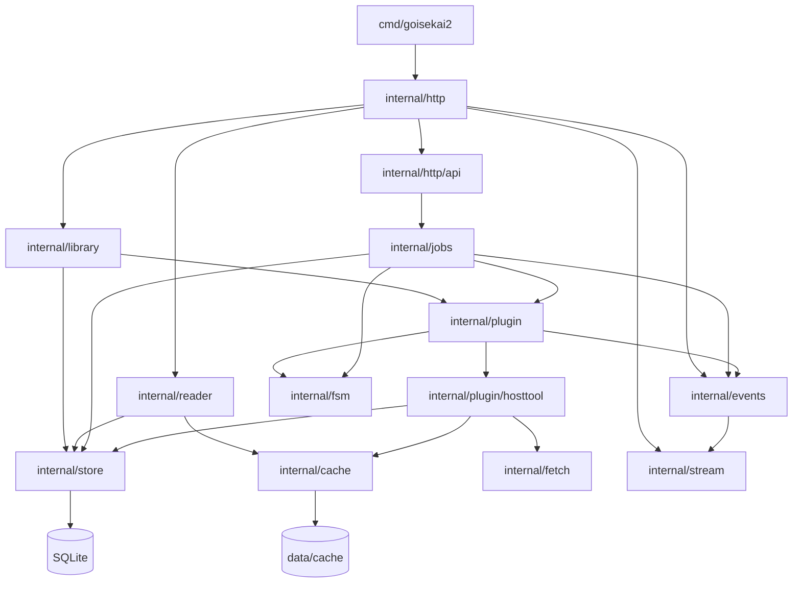
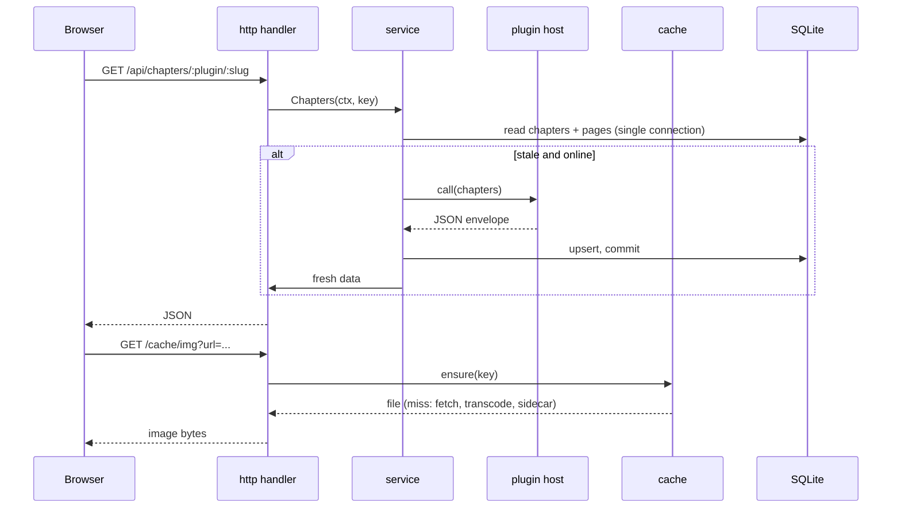

## Shape

One binary, one data directory, one SQLite file, plugin folder per site. No external services: the daemon
serves SSR pages plus a small JSON API, scrapes through plugins, caches images on disk, and persists
everything locally. Porting target is cppIsekai, so every externally visible contract (routes, payloads,
status vocabulary, cache paths, plugin ABI) is fixed by the baseline; only internals are ours.



## Layers and import rules

| Layer | Package | May import | Must not import |
|---|---|---|---|
| Entry | `cmd/goisekai2` | everything (wiring only) | -- |
| Transport | `internal/http` | library, reader, jobs, config, events, stream, model | plugin internals, sqlite driver |
| Domain services | `internal/library`, `internal/reader`, `internal/jobs` | store, plugin (hub interface), cache, events, fsm, model | http, templates |
| Plugin host | `internal/plugin` (hub, runtimes) | fsm, events, hosttool, model | store directly, http, cache internals |
| Host tools | `internal/plugin/hosttool` | fetch, store interface, cache interface, crypto/text helpers | http, templates, plugin runtimes |
| Infrastructure | `internal/store`, `internal/cache`, `internal/fetch` | model, config | any service, http, plugin |
| Leaves | `internal/events`, `internal/stream`, `internal/fsm`, `internal/model` | stdlib (+ `gookit/event`, `stateless` inside their wrappers) | everything else |

Hard rules:

1. `internal/model` holds shared structs and enums only; it imports stdlib and nothing from this repo. Every
   other package may import it, so it can never depend upward.
2. `internal/store` is the only package that speaks SQL. Plugins reach data through host tools
   (`storage.get/set`), never through the driver -- the baseline enforces the same rule by routing plugin
   storage through the db worker (`src/main.cpp:106`).
3. No `init()` side effects and no package-level mutable singletons. All wiring happens in `cmd`.
4. `events`, `stream` and `fsm` are leaves: importing them never drags in the store or HTTP.
5. Guest plugin code (Lua/JS/WASM) never imports Go. It only sees the host-tool table, payloads as JSON text.

## Request paths (baseline parity)



Reads are store-first. Network work only happens on a miss, a stale hit or an explicit refresh, and every
write is committed before any event is published.

## External contracts (frozen by the baseline)

| Contract | Source |
|---|---|
| Routes and payload shapes | `src/http/*`, `openspec/specs/*` in cppIsekai |
| Plugin ABI, host tools, method vocabulary | `src/plugin/*`, `knowledge/architecture/plugin-system.md` |
| Status vocabulary | `Ongoing|Completed|Hiatus|Dropped|Upcoming`, tolerate upstream `Ongoin` |
| Cache tree | `img/<plugin-ns>/cover/<sha1-16>.<ext>`, `img/<plugin-ns>/manga/<slug>/ch<n>-<id8>/pNNN.<ext>` |
| Config knobs and precedence | `src/config/registry.hpp`: default < ini < env < flag, `--dump-config` |
| Reader window | limit 10, strictly-after position, per-chapter slices |

Everything else -- package layout, event bus, FSM, worker model -- is internal and free to diverge, provided
the tables above do not move.

## Data directory

```
data/
  library.db          SQLite (WAL), backups as library-YYYYmmdd-HHMMSS.db
  cache/img/...       v3 tree, LRU over bytes
  plugins/<site>/     main.json + entry (lua|js|wasm)
  enrichment/<plug>/  optional enrichment plugins
  logs/goisekai.log   append-only
```

## Stack decisions

| Area | Choice | Status |
|---|---|---|
| HTTP | `net/http` + `html/template` + htmx fragments | decided (stdlib-first convention) |
| Events | `gookit/event` behind one actor | decided (`decisions/event-dispatch`) |
| FSM | `qmuntal/stateless` behind typed wrappers | decided (`decisions/state-machine-engine`) |
| SQLite driver | `modernc.org/sqlite` v1.62.0 (pure Go, BSD-3) | decided |
| HTTP client | `bogdanfinn/tls-client` v1.18.1 (pure Go via utls, BSD-3) | decided |
| Lua runtime | `github.com/yuin/gopher-lua` v1.1.2 (pure Go, Lua 5.1) | decided |
| JS runtime | `github.com/dop251/goja` (pure Go; V1 already ran its JS plugins on goja) | decided |
| WASM runtime | `github.com/tetratelabs/wazero` v1.12.0 (pure Go, Apache-2.0) | decided |
| Real-time | SSE hub (`internal/stream`) | open: baseline uses WS `/ws/log` |

Hard constraint: **no cgo anywhere**. The build gate is `CGO_ENABLED=0 go build ./...`, so any dependency
that needs a C toolchain is rejected outright -- that excludes `mattn/go-sqlite3`, `buke/quickjs-go` (cgo,
45 vendored C files, self-declared not production ready) and `wasm3` (C). Rationale and the QuickJS-on-WASI
escape hatch are in `decisions/dependency-stack`.

Remaining compatibility gates (not blockers, but they decide behaviour):

1. **gopher-lua is Lua 5.1, not LuaJIT.** The baseline embeds LuaJIT; 5.1 semantics match, LuaJIT extras (`ffi`,
   `bit`) do not. Any plugin needing them is a runtime bug we must surface explicitly.
2. **goja handles ES2020 syntax, but not promise settling.** Verified by execution, not by docs:
   `?.`, `??`, `BigInt`, spread, template literals and classes all pass; `Promise` exists, but microtasks are
   not pumped, so `async`/`await` leaves values `pending`. That is an ABI limit, not an engine limit: the
   plugin contract is synchronous `call(method, json) -> json`, so async plugins cannot return a value under
   any runtime, QuickJS included. Accepting them later means adding a job pump to the host. If real QuickJS
   semantics are ever required, the cgo-free route is quickjs-ng compiled to a WASI reactor on wazero.

## Known divergences to record

1. **Realtime transport**: the baseline ships WebSocket `/ws/log` with snapshot replay. A single SSE
   endpoint per client removes the WS dependency and matches the stream hub, but it changes the transport.
   Either keep a minimal WS endpoint for parity or accept an additive SSE route; decide before the HTTP
   capability spec.
2. **Job table**: added for durable cancel/retry (baseline keeps retry in `update_attempts` only).
3. **Plugin state columns**: added for FSM persistence; API still exposes boolean `enabled`.

# Related Concepts
- [Concurrency and ownership: one owner per mutable resource, bounded everything](concurrency-ownership.md): layer boundaries are enforced by the single-owner concurrency model
- [Event-driven core: domain events on gookit/event, stream plane separate](event-driven-core.md): transport and services publish domain facts through the bus
- [State machines: plugin and job lifecycle on qmuntal/stateless; cache entry and daemon deliberately not](state-machines.md): plugin and job lifecycles live in the domain service layer
- [Dependency stack: pure Go only (modernc sqlite, tls-client, gopher-lua, goja, wazero)](../decisions/dependency-stack.md): names the concrete pure-Go libraries behind each stack slot
