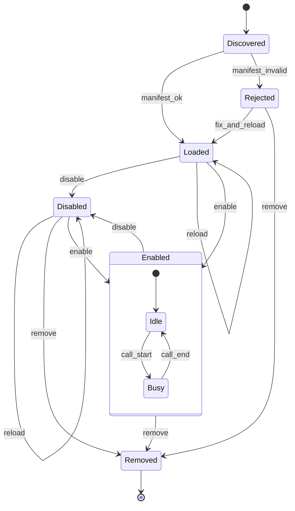
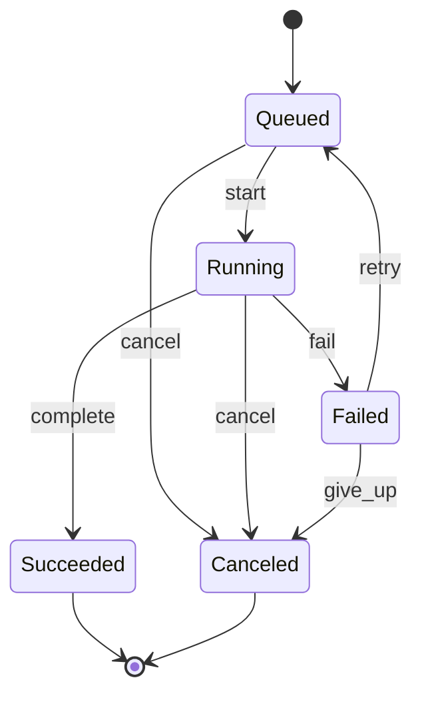

## Scope

Four lifecycles need explicit rules; only two get the engine. The split is deliberate: an engine per
image entry would allocate thousands of machines for a transition set that is trivial.

| Entity | Mechanism | Why |
|---|---|---|
| Plugin instance | `qmuntal/stateless` machine | many states, illegal transitions under concurrency (user toggle vs reload vs in-flight call), side effects must run once |
| Sync/refresh job | `qmuntal/stateless` machine | cancel vs completion race, retry with backoff, must survive restart |
| Image cache entry | typed enum + singleflight reservation | thousands of entries; states are `absent/fetching/ready/failed`, one owner, no guards beyond a fetch deadline |
| Daemon lifecycle | ordered slice | linear boot/shutdown; no branching, no illegal transition to model |

Config, store, HTTP and the bus are **not** state machines: they are resources or registries with a single
lifecycle. Wrapping them adds a layer with no "which transitions are legal" question to answer.

## Engine and wrapper rules

`qmuntal/stateless` v1.8.0 (port of .NET Stateless), BSD-2, zero transitive deps, Go >= 1.24. It provides
guards, hierarchical states, entry/exit actions, internal/ignored transitions, run-to-completion firing,
external state storage and DOT export. We borrow the engine and keep the domain:

1. `State` and `Trigger` in the library are `any`. Each machine therefore lives behind typed enums and a
   wrapper whose methods accept only those enums (`PluginState`, `PluginTrigger`, `JobState`, `JobTrigger`).
   A wrong trigger is a compile error at the call site; a runtime mismatch lands in `OnUnhandledTrigger`.
2. One owner goroutine per manager fires every trigger. The library is thread-safe, but ordering must be
   deterministic and every transition must persist before the event is published.
3. Callbacks (`OnEntry`, `OnExit`, `OnTransitioned`) never do I/O beyond the state write: they enqueue work
   or publish an event. Scraping and HTTP stay out.
4. `FiringQueued` (the default) is mandatory: a callback may fire another trigger without deadlocking; it is
   processed after the current transition completes.
5. Timeouts are synthetic triggers from the owner (`TrigTimeout`), never timers inside the machine.

## Machine A -- plugin instance

Grounded in the baseline: `plugin_load.cpp:214-219` accepts only `lua|js|wasm`, `plugin_load.cpp:221-223`
skips plugins whose `api` is newer than the host, `plugin.hpp:79-82` warns and continues when a plugin is
broken, and the runtime mutex allows one call at a time per plugin (`plugin_internal.hpp:43`).

| Trigger | Guard | Effect |
|---|---|---|
| `manifest_ok` | runtime in `lua|js|wasm`, `api` <= host | register runtime, record capabilities |
| `manifest_invalid` | -- | store reason, log warn, keep scanning (baseline behavior) |
| `enable` | state is `Loaded|Disabled`, runtime present | clear scheduler gate, publish `plugin.lifecycle` |
| `disable` | not `Busy` | gate next call, cancel queued jobs, publish `plugin.lifecycle` |
| `reload` | not `Busy` | re-read manifest, re-register runtime, publish `plugin.lifecycle` |
| `call_start` / `call_end` | `Enabled` only | acquire/release the per-plugin runtime slot |
| `remove` | not `Busy` | delete runtime, rows, cache namespace; publish `plugin.lifecycle` |

Health is **not** a state: a failing call increments counters and records `last_error` (baseline keeps
`CallHealth{ok,error,at}`, `plugin.hpp:61-66`). Putting "failing" into the machine would make every scrape
error a transition and explode the graph.

Persisted (new columns on `plugin`, divergence recorded in the decision): `state`, `state_reason`,
`state_version`. The public API keeps the baseline contract: a boolean `enabled`, derived from the state.

## Machine B -- sync/refresh job

The baseline has no job table; refresh work is inline plus scheduler ticks, with retry bookkeeping in
`update_attempts` (`backoff_until`, `consecutive_errors`). V2 promotes it to a durable job so cancel and
crash recovery are expressible.

- `retry` guard: `attempts < max_attempts` and `now >= backoff_until` (baseline backoff semantics).
- `fail` effect: increment `consecutive_errors`, compute the next `backoff_until`, store `last_error`.
- Boot reconciliation: a row in `Running` with no live worker is fired `fail{reason=interrupted}` then may
  `retry`; a row in `Queued` is re-enqueued in FIFO order.
- `TrigTimeout` guard: `running_since + timeout < now` -> `Failed` with reason `timeout`.

## Machine C -- image cache entry (no engine)

States: `Absent -> Fetching -> Ready | Failed`, `Ready|Failed -> Absent (evict)`.

- The cache package keeps `map[cacheKey]entryState` under its own mutex, plus a reservation map: the first
  `request` for `Absent/Failed(backoff elapsed)` becomes the fetcher; everyone else waits on that entry's
  done channel (singleflight semantics, ~40 LOC, no dependency).
- Disk is the source of truth across restarts: `Ready` is recomputed from the file plus sidecar, never
  persisted. The in-memory state exists to prevent duplicate fetches, which is the baseline's
  `img_ensure` wrap (`cache.hpp:112-117`).
- `Evict` is driven by the LRU, not by a trigger fired from a request path.

Using the stateless engine here would allocate one machine per cached image and encode two transitions;
the reservation map already provides the required exclusion.

## Daemon lifecycle (ordered slice, not a machine)

Boot order derived from `src/main.cpp:4-139`: resolve config -> create data dirs -> start browser host
(abort if unavailable) -> open store + migrate -> log buffer -> worker pools -> plugin load_all -> cache
namespace snapshot -> scheduler -> tray -> HTTP serve. Shutdown: stop HTTP -> stop scheduler -> drain jobs ->
drain bus -> close stream hub -> stop browser -> close store.

In Go the browser host is optional per plugin capability; the rest of the order is preserved because plugin
loading and cache namespaces read the store, and the scheduler must not start before jobs exist.

## Cross-cutting rules

1. **Persist before publish.** The external-state mutator writes the row (and bumps `state_version`) inside
   the transition; `OnTransitioned` then publishes the domain event. A crash between the two leaves a
   persisted state with a missing event, which the boot reconciler emits idempotently.
2. **Stale events are dropped** by comparing `state_version` in the subscriber, not by locking the machine.
3. **Illegal trigger** -> `OnUnhandledTrigger` returns a typed error, increments
   `fsm_unhandled_total{entity}`, logs at warn with `(entity, state, trigger)`. No panic, no silent ignore.
4. **Introspection for UI**: `PermittedTriggers` produces the enabled/disabled button set, so the UI never
   guesses which action is legal. This replaces the baseline's unconditional `POST /plugin/<id>/enabled`.
5. **Graph snapshot test**: `ToGraph()` output is asserted against a checked-in golden file; any model change
   without a test update fails CI, and the DOT file is the diagram source of truth.
6. **One machine instance per entity**, owned by its manager; machines are never shared across entities.

## Divergences from cppIsekai (must become OpenSpec MODIFIED deltas)

| Divergence | Why | Observable impact |
|---|---|---|
| `plugin.state`, `state_reason`, `state_version` columns | persist transitions and reconcile on boot | none: API still exposes `enabled` |
| `jobs` table | durable cancel + crash recovery | new internal table; no route contract change |
| `PermittedTriggers` in plugin API payloads | UI no longer guesses legal actions | additive field only |

Status vocabulary from sites (`Ongoing|Completed|Hiatus|Dropped|Upcoming`, plus the tolerated upstream
`Ongoin` typo) is data, not machine state, and stays untouched.

## Testing

- Full transition matrix per machine: every `(state, trigger)`, legal and illegal, asserted.
- Persist-before-publish ordering: fake store records the write, listener records the event, assert order.
- Boot reconciliation: rows in `Enabled`/`Running` with no runtime/worker converge to `Loaded`/`Failed`.
- Graph golden test per machine.
- `go test -race` for the manager actors; goroutine-leak check after shutdown.

# Related Concepts
- [Event-driven core: domain events on gookit/event, stream plane separate](event-driven-core.md): plugin and job transitions are the source of domain events; persist-then-publish ordering
- [Use qmuntal/stateless as the FSM engine behind typed domain wrappers](../decisions/state-machine-engine.md): implements the engine choice and wrapper rules
