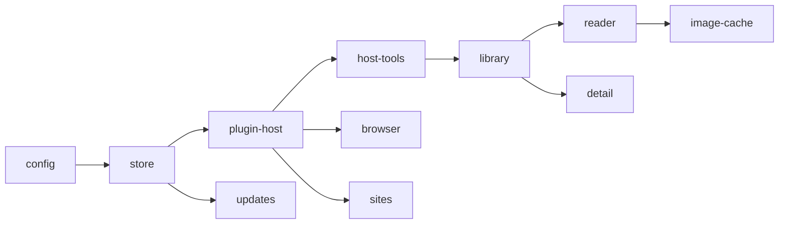

# Capability porting order

Authoritative execution order for the 11 V2 capabilities. All 11 specs already exist in
`openspec/specs/`; each capability is then *implemented* as one OpenSpec change, in this order.
A change is archived before the next one starts.

| # | capability | change id | depends on | state |
|---|---|---|---|---|
| 1 | config | `add-config` | — | archived |
| 2 | store | `add-store` | config | active |
| 3 | plugin-host | `add-plugin-host` | store | pending |
| 4 | host-tools | `add-host-tools` | plugin-host | pending |
| 5 | library | `add-library` | host-tools, store | pending |
| 6 | reader | `add-reader` | library | pending |
| 7 | image-cache | `add-image-cache` | reader | pending |
| 8 | detail | `add-detail` | library, image-cache | pending |
| 9 | updates | `add-updates` | store, plugin-host | pending |
| 10 | browser | `add-browser` | plugin-host | pending |
| 11 | sites | `add-sites` | plugin-host, host-tools | pending |

## Why this order

Dependency edges only point backwards, so no requirement is written against an unspecified
contract. `sites` is last on purpose: it is the integration fixture that proves the plugin ABI, the
host tools and the store agree, so it can only be written once all three are real.

## Rules per change

- **One active change at a time.** `openspec list` must show exactly one before work starts.
- **Branch per change** named after the change id, merged to `main` with `--no-ff`.
- **Artifacts**: `proposal.md` (what/why), `design.md` (D1..Dn decisions, alternatives, consequences),
  `specs/<capability>/spec.md` (ADDED/MODIFIED/REMOVED delta), `tasks.md` (checklist).
- **Delta, not rewrite.** The main spec stays the contract; the change only adds or modifies what it
  touches, and archives into the main spec afterwards.
- **Gate before archive**: `openspec validate --change <id>` clean, every task ticked,
  `CGO_ENABLED=0 go build ./... && go test ./... && go vet ./...` green.
- **Divergence mid-change** goes into a decision concept plus a MODIFIED delta in the same change —
  never silent code.
- **Flip the state column here** when a change archives. This table is the source of truth for
  "what are we building now".

## Status vocabulary

`pending` → `active` (change created) → `implementing` (tasks in flight) → `archived` (merged and
spec synced). Anything else is not a state; do not invent intermediate labels.

# Related Concepts
- [Capability map: 25 baseline specs collapsed into 11 V2 capabilities](../architecture/capability-map.md)
- [Architecture overview](../architecture/overview.md)
- [Capability map: 25 baseline specs collapsed into 11 V2 capabilities with a porting order](../architecture/capability-map.md): defines the execution order and per-change gates for the capabilities mapped here
- [Architecture overview: layers, import rules and frozen external contracts](../architecture/overview.md): orders the implementation of the layers described here
