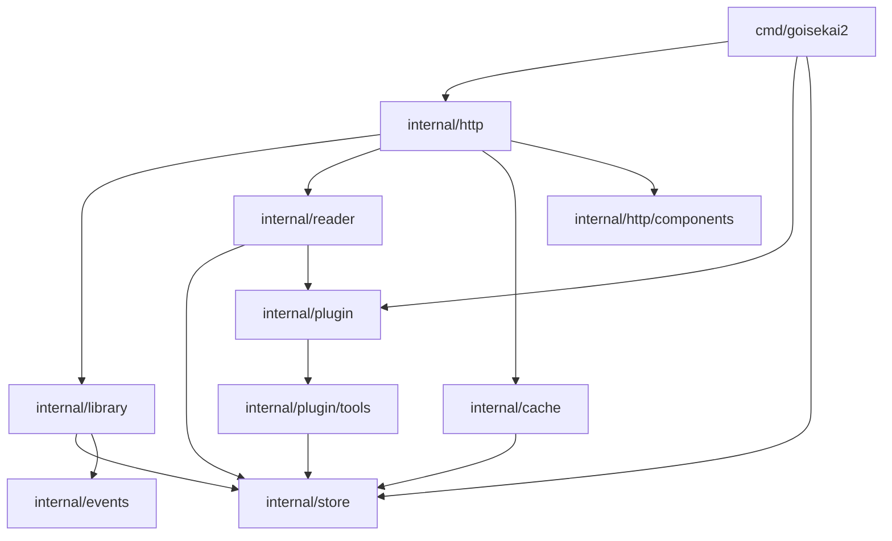
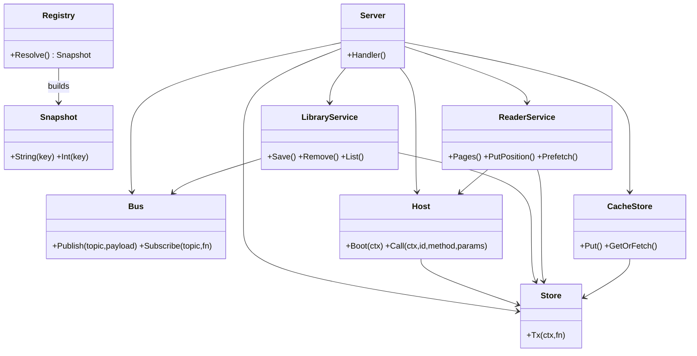

## Where diagrams live

There are no standalone .mmd, .puml or draw.io files. Every diagram is Mermaid, embedded in an OKF concept so it stays versioned with the decision it explains.

| Concept | Diagrams |
|---|---|
| architecture/overview | 2: layer map and request paths |
| architecture/data-flows | 5: save, open chapter, serve image, save config, toggle plugin |
| architecture/state-machines | 2: plugin and job state machines |
| architecture/event-driven-core | 1: event/stream plane split |
| architecture/capability-map | 1: capability dependency map |

## Component graph

## Core class sketch (UML)

## Rule

New diagrams MUST be Mermaid and MUST live in the relevant OKF concept, not in a separate image file. This follows the project AAG rule that diagrams use Mermaid syntax.

# Related Concepts
- [Architecture overview: layers, import rules and frozen external contracts](../architecture/overview.md): Diagram source concept indexed by references/diagrams
- [Data flows: five ordered sequences and the invariants that keep them reproducible](../architecture/data-flows.md): Diagram source concept indexed by references/diagrams
- [State machines: plugin and job lifecycle on qmuntal/stateless; cache entry and daemon deliberately not](../architecture/state-machines.md): Diagram source concept indexed by references/diagrams
- [Event-driven core: domain events on gookit/event, stream plane separate](../architecture/event-driven-core.md): Diagram source concept indexed by references/diagrams
- [Capability map: 25 baseline specs collapsed into 11 V2 capabilities with a porting order](../architecture/capability-map.md): Diagram source concept indexed by references/diagrams
